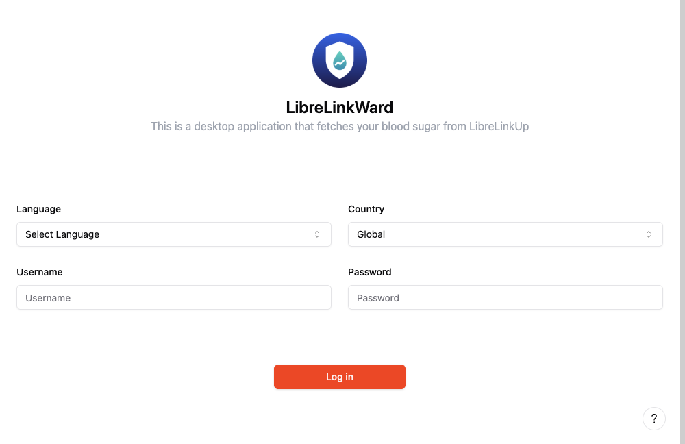
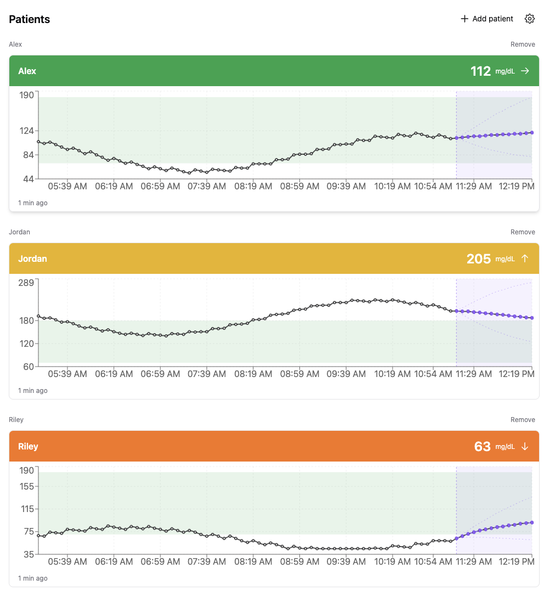
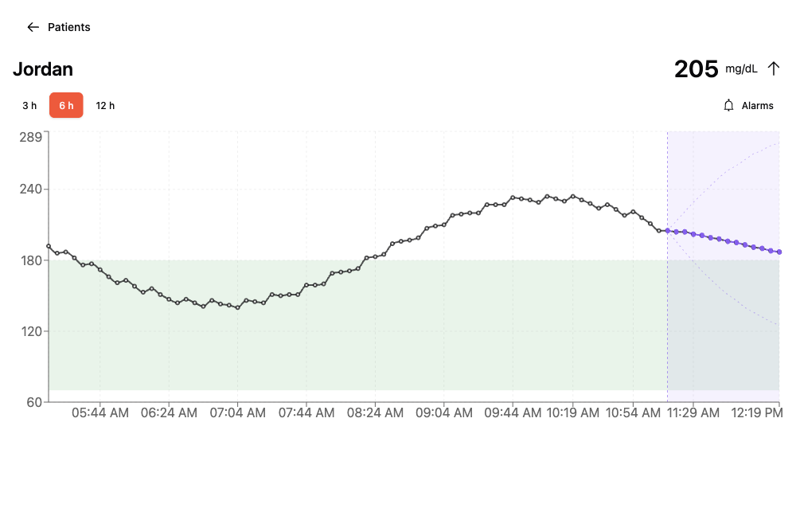
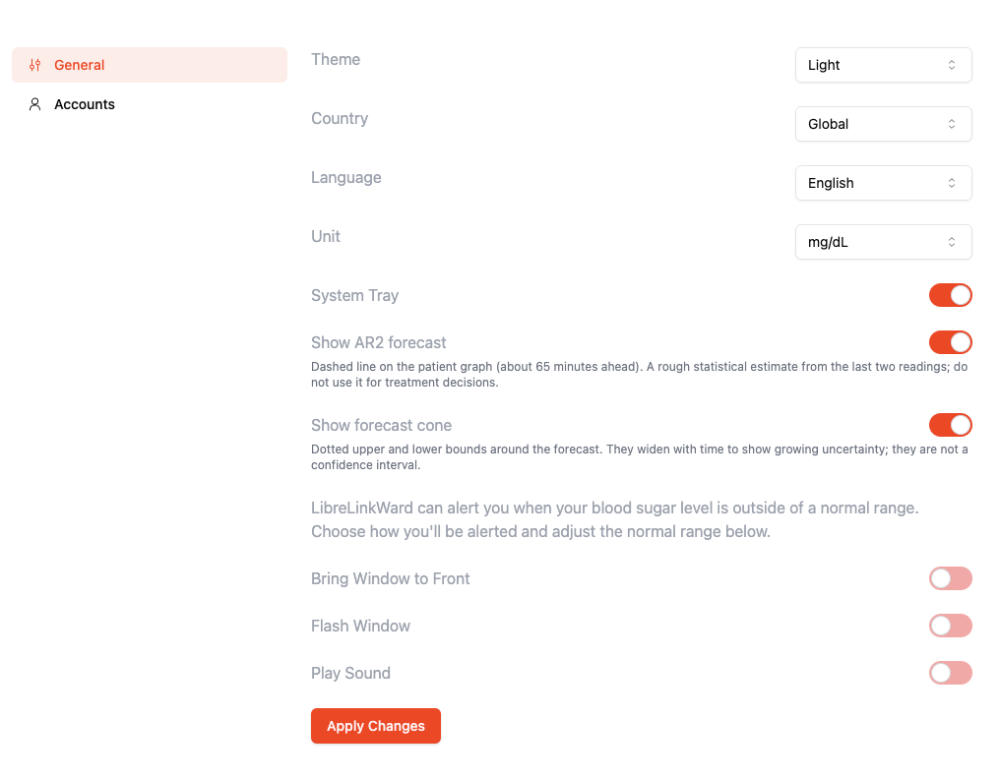
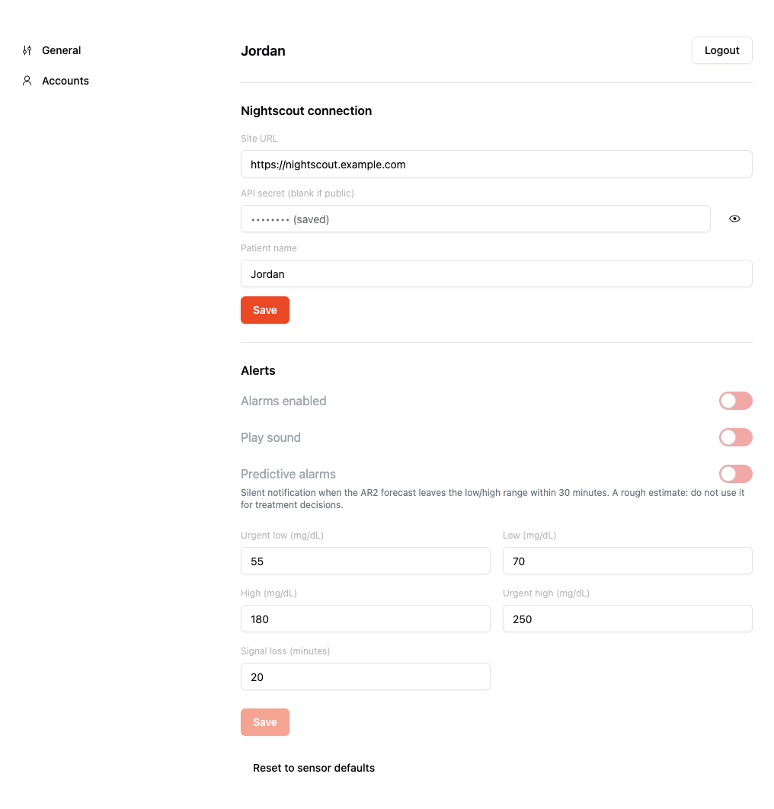

# LibreLinkWard
LibreLinkWard is a desktop application for monitoring blood glucose from [LibreLinkUp](https://librelinkup.com/), aimed at nurses and carers who follow **multiple patients** at once.

It is a fork of [LibreLinkUpDesktop](https://github.com/Crazy-Marvin/LibreLinkUpDesktop) by Crazy Marvin & Contributors (Apache-2.0). See [Acknowledgements](#acknowledgements) and [CHANGES.md](CHANGES.md).

> **Disclaimer:** LibreLinkWard is not a medical device and is not affiliated with Abbott. It relies on an unofficial API and must not be the sole means of monitoring a patient.

Under the hood, [Electron](https://www.electronjs.org/) is used with [TypeScript](https://www.typescriptlang.org/) and [React](https://react.dev/).
As there is no official API from [Abbott](https://www.freestyle.abbott/), the LibreLinkUp API is used directly, following the approach of the [client from DiaKEM](https://github.com/DiaKEM/libre-link-up-api-client).

## Features
- Monitor **several patients** at once: one card per patient with value, trend, a 6 h graph and "x min ago", coloured by that patient's own thresholds.
- Patient page with a 3/6/12 h graph, target band and hover tooltip (value, unit, time).
- **Per-patient alarms**: urgent low / low / high / urgent high and signal loss, with acknowledge and snooze. The banner names the patient.
- Optional **AR2 forecast** on the graphs (dashed line and uncertainty cone, about 65 minutes ahead) and optional per-patient **predictive alarms** (silent notification when the forecast leaves the range within 30 minutes). Both are rough statistical estimates, not for treatment decisions.
- **System tray** icon with the latest readings; the tooltip lists every patient.
- Optional, per-patient **Nightscout upload** (off by default).
- **Nightscout as a reading source**: add a Nightscout site as a patient (read-only).
- Credentials stored with the OS keychain (Electron `safeStorage`); no tracking. See [PRIVACY.md](PRIVACY.md).
- mg/dL and mmol/L, dark mode.

## Setup
1. Install LibreLinkWard from [GitHub Releases](https://github.com/koumoutsas/LibreLinkWard/releases). Builds are **not notarized**, so macOS and Windows warn on first launch (see below).
   - **macOS**: opening the app shows _"Apple could not verify “LibreLinkWard” is free of malware…"_. Click **Done** (not _Move to Trash_), open _System Settings > Privacy & Security_, scroll to **Security**, click **Open Anyway** next to the LibreLinkWard message and confirm with your password. This is needed once; the app opens normally afterwards. Right-click > Open no longer works on macOS 15 and later. To skip the dialogs, run `xattr -cr /Applications/LibreLinkWard.app` in Terminal.
   - **Windows**: SmartScreen shows a warning; click **More info** then **Run anyway**.
2. Sign in with a patient's LibreLinkUp credentials. The operator needs no Libre account of their own.
3. Press **Add patient** on the dashboard and enter the next patient's credentials. Each login becomes its own view, stacked vertically below the others. Remove a view with **Remove**.

Each login is verified before it is saved, and all logins are polled once a minute. Adding the same credentials twice creates two independent views (useful for testing); each view has its own alarms and Nightscout settings, so a real deployment should not add a patient twice. A login that is a follower account with several shared patients shows all of them in its view.

## Usage
- **Dashboard**: one view per login, each with the patient's value, trend and a 6 h graph (hover for value and time). Click a view for the patient page (3/6/12 h graph); its **Alarms** button opens that patient's alarm settings. Views are coloured by that patient's own thresholds.
- **Settings > Accounts** lists each login with its patients' alarms (and Nightscout upload for LibreLinkUp logins). The window, flash and sound behaviour is under **Settings > General**.
- **Logout** (Settings > Accounts, per login) removes that login and its patients.

### Alarms
Each patient has their own configuration. Defaults: urgent low 55, low = sensor target low (70), high = sensor target high (180), urgent high 250 mg/dL; signal loss after 20 min. Thresholds are shown in your chosen unit.

- Hysteresis of 5 mg/dL before an alarm clears; it repeats every 5 min until acknowledged; moving to a more severe level notifies again.
- **Acknowledge** silences the current alarm. **Snooze** (15/30/60 min) suppresses all alarms for that patient, **including urgent low**.
- Sound and window flash are triggered by the app window, so keep the app running (hidden to the tray is fine). Alarm snoozes are not kept across restarts.

### Nightscout as a reading source
Choose _Add patient_ -> _Nightscout site_, enter the site URL, the API secret (leave blank for a public site) and an optional name. The app reads `GET /api/v1/entries/sgv.json` once a minute for the last 12 h, so the site shows up as one patient with its own graph and alarms. The site's target range (`bgTargetBottom`/`bgTargetTop` from its status, refreshed hourly) sets the default alarm thresholds and the target band; you can still override them per patient. The URL, API secret and name can be changed later under Settings > Accounts; the new settings are checked before they replace the old ones, and the patient keeps its alarms. A rejected secret stops polling until you enter a working one there. Directions map to the app's five trend arrows (double arrows show as single).

### Nightscout upload (optional)
In Settings > Accounts, under a LibreLinkUp login's patient, enable Nightscout and enter the URL, API secret and a device name, then press _Test_. New readings are uploaded via API v1 (`POST /api/v1/entries`), resuming after Nightscout's newest entry so nothing is duplicated, and retried with backoff on failure. Only readings still in the app's 12 h memory can be uploaded, so an outage longer than 12 h loses data. The secret is stored encrypted and only shown again when you press the eye button next to it.

## Build
Requires Node 22.15+. `npm install --legacy-peer-deps`

| Command | Purpose |
|---|---|
| `npm start` | development |
| `npm test` / `npm run test:coverage` | unit + integration tests (coverage gate) |
| `npm run typecheck` | TypeScript check |
| `npm run lint` | ESLint (flat config; warnings fail) |
| `npm run test:mutation` | Stryker mutation testing of `src/shared` (fails below 80%) |
| `npm run package:dir` then `npm run test:e2e` | packaged app + Playwright smoke test |
| `npm run package` | installer for the current OS |
| `npm run screenshots` | regenerate the README screenshots (needs `package:dir` first; uses fictional patients) |
| `npm run deps:outdated` / `npm run deps:deprecated` | outdated and npm-deprecated dependencies |

| OS | Artifacts |
|---|---|
| macOS | dmg (arm64, x64) |
| Windows | nsis `-setup.exe`, msi |
| Linux | AppImage, deb |

### CI
`.github/workflows/ci.yml` runs on pushes to `development` (and `multi-patient`) and on every pull request. For now it runs on macOS only (Windows and Linux will return once the Electron 45 upgrade is verified there). All of these must pass:

- typecheck and lint (warnings fail the build)
- unit and integration tests with a coverage gate
- a packaged-app smoke test (Playwright)
- mutation testing of `src/shared` (Stryker, fails below 80%)

Pushing a `v*` tag runs `build-and-release.yml`, which builds the installers for all three systems and attaches them to the release; it does not re-run the tests. macOS notarization only runs if the `APPLE_ID` / `APPLE_ID_PASS` secrets are set; macOS builds are signed ad-hoc only (no Developer ID), and there is no code signing for Windows yet.

### Dependencies
Dependabot opens weekly pull requests (minor and patch updates grouped; Electron major versions are left to a human). Minor and patch pull requests merge automatically once CI passes. The weekly `dep-health` workflow reports security advisories (`npm audit`) and packages marked deprecated on npm; it is informational and does not block merges or releases.

# Screenshots
The patients shown here are fictional, served by a local mock Nightscout site (`npm run screenshots`).

Login | Dashboard
------------ | -------------
 | 

Patient page with AR2 forecast | General settings
------------ | -------------
 | 

Per-patient alarm settings
------------

# Contributing

See [CONTRIBUTING.md](CONTRIBUTING.md). Privacy: [PRIVACY.md](PRIVACY.md).

# Acknowledgements

LibreLinkWard is built on [LibreLinkUpDesktop](https://github.com/Crazy-Marvin/LibreLinkUpDesktop), created by Crazy Marvin and contributors, especially Yuran Fernando. Thank you for the free software this work stands on.

# License

[Apache License 2.0](LICENSE). See [NOTICE](NOTICE) for attribution.
